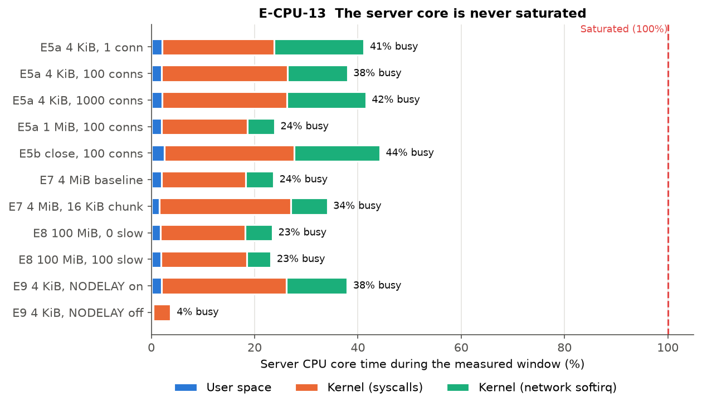
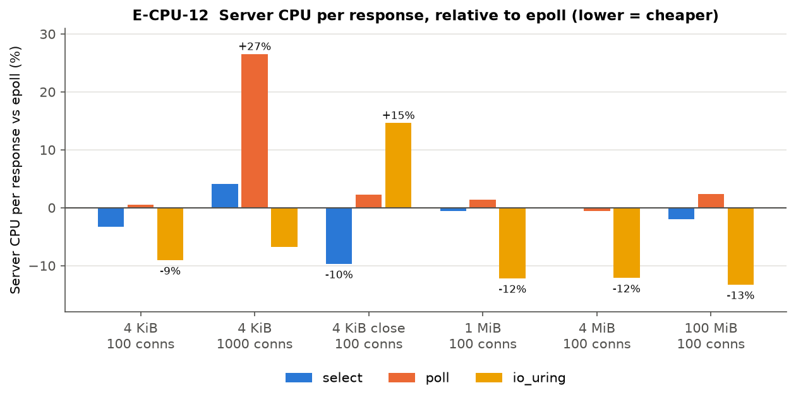

# File Transfer Server — Benchmark Report

Comparison of four I/O backends — **select, poll, epoll, io_uring** — serving files over HTTP/1.1 from the same server code (`code/apps/File-Transfer-Server/filesrv.c`). Only the event-notification layer (`code/io/io_*.c`) changes between backends.

## Key findings

| # | Finding |
|---|---------|
| 1 | **Throughput and mean latency are nearly identical across backends because the server is never saturated.** Its CPU core is 4–48% busy in every test, so the client and the loopback path set the limit, not the backend. |
| 2 | **The backends differ in CPU cost.** io_uring needs **10–13% less** server CPU per response on large files. poll needs **27% more** at 1000 connections. io_uring needs **15% more** when every response opens a new connection. |
| 3 | **The step that differs between backends is ~1% of the server's work.** At 100 connections the server waits for events ~180 times/s and handles ~33 responses per wakeup, against ~17,700 read/write calls/s that are the same code on every backend. |
| 4 | **TCP_NODELAY is the largest single effect.** Turning it off cuts 4 KiB throughput by **62%** (5.9k → 2.27k req/s) because of a Nagle + delayed-ACK stall. |
| 5 | **Chunk size matters; socket buffer sizes do not.** 16 KiB chunks lose **41%** throughput. Changing SO_RCVBUF or SO_SNDBUF has no effect. |
| 6 | **At 1000 connections, poll is 9% slower, and io_uring has a starvation tail:** same throughput, but p99 13.5 s versus 0.24 s for epoll. |
| 7 | **The keep-alive result is inconclusive.** Keep-alive measured +5 to +8% over Connection: close, but the same test varied by 7–12% between sessions. |

## Setup

| Item | Value |
|---|---|
| Machine | Intel i5-10300H (4 cores / 8 threads), WSL2, Linux 6.18.54 |
| Server | Single-threaded, pinned to CPU 1. Sends files with `read()` + `write()` in 64 KiB chunks (no `sendfile` or `mmap`). Header and body are sent as separate writes. TCP_NODELAY is on by default. |
| Client | `wrk`, 4 threads, pinned to CPUs 2–5 (**two physical cores**), over loopback (127.0.0.1) |
| Timing | 10 s warm-up, 30 s measured (90 s for E8), 10 s cool-down |
| Repeats | 5 per test. Plots show the **median**; whiskers show the **IQR** (25th–75th percentile of the 5 runs). |
| Data | 360 runs, 357 accepted. The 3 rejected runs are discussed under E8. |

**Metrics**
- **Throughput:** completed responses/s measured by wrk, or MB/s (10⁶ bytes/s) where file sizes differ. `summary.json` counts responses on the server side, so its figures can differ from wrk's by about 0.2%.
- **Latency:** wrk's mean time from sending the request to receiving the last byte. wrk sends the next request as soon as the previous one completes, so mean latency ≈ connections ÷ throughput (Little's law). It mostly mirrors throughput.
- **Server CPU per response:** user + kernel CPU time of the server process ÷ responses served.
- **Server core busy:** share of CPU 1's time that was not idle during the measured window, from `/proc/stat` (includes network softirq work).

---

## Why the four backends look the same

### The server core is never saturated


- In every test the server's core is idle more than half the time. Even the fastest test (4 KiB at 100 connections) uses only ~38%.
- Going from 1 to 100 connections raises throughput by only 37%, and the core gets slightly *less* busy (41% → 38%). If the server were the bottleneck, it would approach 100%.
- So the limit is outside the server. The most likely cause is wrk, which has only two physical cores (CPUs 2–5 are hyperthread pairs). The WSL2 host may also contribute. Client CPU was not recorded, so this could not be confirmed.
- **Consequence:** a cheaper backend leaves the server idle a bit longer but cannot serve more requests. Throughput graphs **cannot** separate the backends in this setup.

### The step that differs is a tiny share of the work
The only code that changes between backends is the wait-for-events step. Reading requests, reading the file and writing the response are identical. Counts from the server's own counters:

| Test | Wait calls/s | Responses per wakeup | read + write calls/s |
|---|---|---|---|
| 4 KiB, 100 conns | ~180 | 33 | ~17,700 |
| 4 KiB, 1000 conns | 18–55 | 97–282 | ~16,000 |
| 4 MiB, 100 conns | 29–54 | ~1 | ~2,660 |

With many connections, each wakeup returns dozens of ready sockets, so the wait cost is shared across them. Most of the CPU goes to kernel time copying data through TCP (16–25% of the core); user space is only ~2%.

### Where the backends do differ: CPU per response


| Test | select | poll | io_uring |
|---|---|---|---|
| 4 KiB, 100 conns | −3% | +1% | **−9%** |
| 4 KiB, 1000 conns | +4% | **+27%** | −7% |
| 4 KiB, Connection: close | −10% | +2% | **+15%** |
| 1 MiB / 4 MiB / 100 MiB | −2 to 0% | −1 to +2% | **−12 / −12 / −13%** |

- **io_uring is cheaper on large files.** One wakeup returns several completions (29 vs 53 wait calls/s), and a read or write needs no separate readiness check first.
- **poll is expensive at 1000 connections.** Every loop it rebuilds and rescans its 1000-entry `pollfd` array in user space, three passes with a connection lookup each, against two passes for select. Its user CPU rises from ~2% to 9%.
- **io_uring is expensive when every response uses a new connection.** Setting up each connection costs it more (new submissions for each socket), which matches its E5b throughput.
- These differences would show up as throughput only on a saturated server. See *Limitations and future work*.

---

## E5a — File size vs concurrency

### 1. Throughput vs concurrency (4 KiB)


- **1 → 100 connections:** throughput rises by ~37% (4.3k → 5.9k req/s) on every backend. With one connection, the client and server take turns; with 100, the server always has work waiting.
- **100 → 1000 connections:** throughput falls by 7–15%. **poll drops the most (4,989 vs 5,484 req/s for epoll)** because of the O(n) user-space scans described above. epoll reports only the ready sockets.

### 2. Average latency vs concurrency (4 KiB)


- Latency follows **Little's law** (latency = connections ÷ throughput): 100 / 5,925 ≈ 17 ms and 1000 / 5,484 ≈ 182 ms, which matches the measurements. Extra clients only add queueing delay.
- **io_uring at 1000 connections is the outlier:** mean 818 ms, p99 13.5 s, max ≈ 19 s, with the same throughput as epoll, in all 5 runs. Some connections are starved for seconds, so this is a **fairness problem**. A likely cause is the order in which completions are processed and receives re-submitted when 1000 receives are in flight. This was not investigated further.

### 3. Throughput vs file size


- **4 KiB: ~24.5 MB/s.** The fixed cost of each request dominates.
- **64 KiB and 1 MiB: ~170 MB/s on every backend.** This is a shared ceiling. The server core is only ~24% busy at this point, so the limit is not the server.
- **Caution:** this graph mixes concurrency levels. 64 KiB was tested only at 10 connections, and the other sizes at 100.

---

## E5b — Connection behaviour (close vs keep-alive)
4 KiB file, 100 connections, `--max-conns=300`. *Close* sends `Connection: close`, so every file needs a new TCP connection.

### 4. Throughput


| Backend | Close (req/s) | Keep-alive (req/s) | Difference |
|---|---|---|---|
| select | 5,309 | 5,314 | 0% |
| poll | 5,090 | 5,488 | +7.8% |
| epoll | 5,125 | 5,389 | +5.2% |
| io_uring | 4,774 | 5,164 | +8.2% |

### 5. Latency


- **Expected effect:** keep-alive skips `accept()`, `close()`, the TCP handshake and per-socket setup in the backend. io_uring gains the most, which matches its +15% CPU per response under *close*.
- **The throughput result is inconclusive.** The keep-alive half of E5b is the same test as E5a at 100 connections, yet it measured **7–12% lower** (epoll: 5,389 vs 5,925 req/s). The two halves of E5b also ran in separate sessions. Variation between sessions is larger than the 5–8% effect.
- On loopback a handshake costs almost nothing. On a real network each new connection adds at least one round trip, so keep-alive would matter much more there.

---

## E7 — Buffer sensitivity
4 MiB file, 100 connections, application buffer 256 KiB.

### 6. Throughput vs buffer setting


### 7. Latency vs buffer setting


| Setting | Throughput | Latency per 4 MiB | Server CPU per file |
|---|---|---|---|
| Baseline (64 KiB chunk) | ~169 MB/s | ~2.5 s | ~5.4 ms |
| **16 KiB chunk** | **~99 MB/s (−41%)** | **~4.2 s (+70%)** | **~13 ms (2.4×)** |
| SO_RCVBUF = 512 KiB | ~169 MB/s | ~2.5 s | ~5.4 ms |
| SO_SNDBUF = 64 KiB | ~169 MB/s | ~2.5 s | ~5.4 ms |

- **Chunk size is the only setting that matters.** 16 KiB chunks mean 4× as many read → write cycles per file, and 2.4× the server CPU per file. The server core is still only ~34% busy, though, so the server is not the bottleneck. The throughput loss most likely comes from 4× as many smaller writes, which add work on the client and loopback side for every chunk. We did not measure the client, so this is not confirmed.
- **SO_RCVBUF has no effect** because the server only receives a small `GET` request.
- **SO_SNDBUF = 64 KiB has no effect** because one 64 KiB chunk still fits, and Linux doubles the requested value.
- **Not tested:** the application buffer (`--buf-size`) stayed at 256 KiB in every run, so this was a 4-point check rather than a full sweep.

---

## E8 — Slow readers
100 fast wrk clients each download a 100 MiB file, alongside 0, 10 or 100 `curl` readers limited to 100 KiB/s each. Window: 90 s.

### 8. Throughput vs slow readers


### 9. Latency vs slow readers


- **0 or 10 slow readers:** no measurable effect. Throughput stays at ~170 MB/s, and each download takes ~62 s.
- **100 slow readers:** fast-client throughput falls to 151–158 MB/s (−7 to −11%), and each download takes 67–70 s.
- **Why the effect is small:** all four servers are non-blocking. A slow reader's socket fills up and its write waits (`EAGAIN`, or a pending io_uring request), while the loop keeps serving everyone else. The 100 slow readers together take ~10 MB/s (100 × 100 KiB/s), close to the bandwidth the fast clients lose.
- **"Latency" here means the time to download a whole 100 MiB file**, not a single small request as in the other experiments.
- **These results are optimistic.** Run 3 at 100 slow readers was rejected for select, poll and epoll because no fast download finished within 90 s. That was the worst outcome, and dropping it leaves n = 4 for those tests. The failure hit the same run on three backends, which points to a host slowdown rather than a backend bug. The window is also short: one download takes ~62 of the 90 s, so each connection completes only about one request.
- The slow readers' own throughput and fairness were not measured.

---

## E9 — TCP_NODELAY
100 connections, 4 KiB and 64 KiB files. The only change is `TCP_NODELAY` on accepted sockets.

### 10. Throughput


### 11. Latency


| File | NODELAY on | NODELAY off | Effect |
|---|---|---|---|
| 4 KiB | ~5.9k req/s, 17 ms | 2.27k req/s, 44 ms | **−62% throughput, 2.6× latency** |
| 64 KiB | ~2.56k req/s, 39 ms | ~2.58k req/s, 39 ms | none |

- **Why 4 KiB collapses (Nagle + delayed ACK):**
  1. The server sends the HTTP header and the body as two `write()` calls.
  2. The 4 KiB body is smaller than one TCP segment (on loopback a segment is ≈ 64 KiB).
  3. With Nagle on, TCP holds the body until the header is acknowledged, and the client delays that ACK by ~40 ms.
  4. Check: 100 connections ÷ 44 ms ≈ **2,270 req/s**, exactly as measured on all four backends. The server core is only ~4% busy here, because it is just waiting.
- **Why 64 KiB is unaffected:**
  1. The body (65,536 bytes) is slightly larger than one segment (65,483 bytes).
  2. The first full segment is sent immediately, and Nagle holds only a 53-byte tail.
  3. Receiving more than one full segment makes the client ACK immediately, which releases the tail almost at once.
- The effect is identical on every backend because it happens entirely in the kernel's TCP stack. **Recommendation:** keep TCP_NODELAY on (the current default), or send the header and body with one `writev()`.

---

## Conclusions

1. **In this setup the backends tie on throughput and mean latency because the server is never saturated.** The client and loopback set the limit, and the backend-specific step is ~1% of the work.
2. **The backends do differ in CPU cost.** io_uring is ~12% cheaper per large file. poll is 27% more expensive at 1000 connections. io_uring is 15% more expensive when every response needs a new connection. On a saturated server these differences would become throughput differences.
3. **Socket and protocol settings matter far more than the backend:** TCP_NODELAY (2.6× latency) and chunk size (−41% throughput).
4. **At high connection counts the backends start to differ:** poll's O(n) scans cost 9%, and io_uring shows a serious tail-latency and fairness problem.

## Limitations and future work

| Limitation | Fix |
|---|---|
| Server never saturated; client likely the bottleneck | Cap the server with a cgroup (for example `cpu.max = 25000 100000`, 25% of a core) so it becomes the bottleneck. The runner already supports `cgroup_cpu_stat`. Count only runs where the server was throttled. |
| Client CPU not recorded; client on 2 physical cores; server shares a core with CPU 0 | Set `client_cpu_stat`. Pin the server to CPU 2 and leave CPU 3 idle, and give wrk CPUs 4–7. Better still, run wrk on a second machine. |
| Closed-loop latency adds nothing beyond throughput | Add a fixed-rate test (for example `wrk2 -R`) to measure latency at a set load. |
| E5b halves ran in separate sessions | Rerun close and keep-alive in one session, in random order. |
| E5a mixes concurrency and file size; E7 never varied `--buf-size` | Run a full size × concurrency grid; sweep `--buf-size` and chunk size. |
| E8 window too short; slow readers not measured | Use a window of 3× the download time, and record the slow readers' throughput. |
| Only 5 runs per test, no significance testing | More runs, plus confidence intervals or a Mann-Whitney test before claiming differences under 5%. |
| Loopback on WSL2 (~64 KiB segments, no real RTT) | Repeat key tests over a real network. |
| io_uring tail at 1000 connections not explained | Profile completion order; try multishot receive and provided buffers. |

## Reproducing

```bash
python report/file-transfer/make_figures.py
```
This reads the raw runs in `code/results/File Transfer Server/benchmarking-results/`, using accepted runs only. It writes `figures/*.png` and `data.json`, which holds per-test medians, IQR and n for throughput, latency, CPU per response, core usage and syscall rates, plus the list of rejected runs.
