# File Transfer Server — Benchmark Report

Comparison of four I/O backends — **select, poll, epoll, io_uring** — serving files over HTTP/1.1 from the same server code (`code/apps/File-Transfer-Server/filesrv.c`). Only the event-notification layer (`code/io/io_*.c`) changes between backends.

## Key findings

| # | Finding |
|---|---------|
| 1 | **Backend choice barely matters for file transfer.** In most cells all four backends are within ~3% of each other. |
| 2 | **Large files reach a ~170 MB/s ceiling on every backend.** The server uses only ~20% CPU at that point, so the limit is outside the event loop (client, loopback copy, WSL2). |
| 3 | **TCP_NODELAY is the biggest single factor.** Turning it off cuts 4 KiB throughput by **62%** (5.9k → 2.27k req/s) because of the Nagle + delayed-ACK stall. |
| 4 | **Chunk size matters; socket buffer sizes do not.** A 16 KiB chunk loses **41%** throughput. Changing SO_RCVBUF/SO_SNDBUF has no measurable effect. |
| 5 | **At 1000 connections, poll is slowest (−9%) and io_uring has a starvation tail:** same throughput, but 4.5× the mean latency and p99 of 13.5 s versus 0.24 s for epoll. |
| 6 | **Slow readers hurt only at scale.** With 10 slow readers nothing changes. With 100, fast-client throughput drops by 7–11%. |
| 7 | **Keep-alive helps modestly:** +5 to +8% for poll, epoll and io_uring, and 0% for select. Loopback makes TCP handshakes cheap. |

## Setup

| Item | Value |
|---|---|
| Machine | Intel i5-10300H (4C/8T), WSL2, Linux 6.18.54 |
| Server | Single-threaded, pinned to CPU 1. Sends files with `read()` + `write()` in 64 KiB chunks (no `sendfile`/`mmap`). Header and body are sent as separate writes. TCP_NODELAY is on by default. |
| Client | `wrk`, 4 threads, pinned to CPUs 2–5, over loopback (127.0.0.1) |
| Timing | 10 s warm-up, 30 s measured (90 s for E8), 10 s cool-down |
| Repeats | 5 per cell. Each plot shows the **median**; whiskers show the **IQR** (25th–75th percentile). |
| Data | 360 runs, 357 accepted. The 3 rejected runs are explained under E8. |

**Metrics.** Throughput is completed responses/s from wrk, or MB/s (10⁶ bytes/s) where file sizes differ. Latency is wrk's mean request latency: the time from sending the request to receiving the last byte of the file.

---

## E5a — File size vs concurrency

### 1. Throughput vs concurrency (4 KiB)
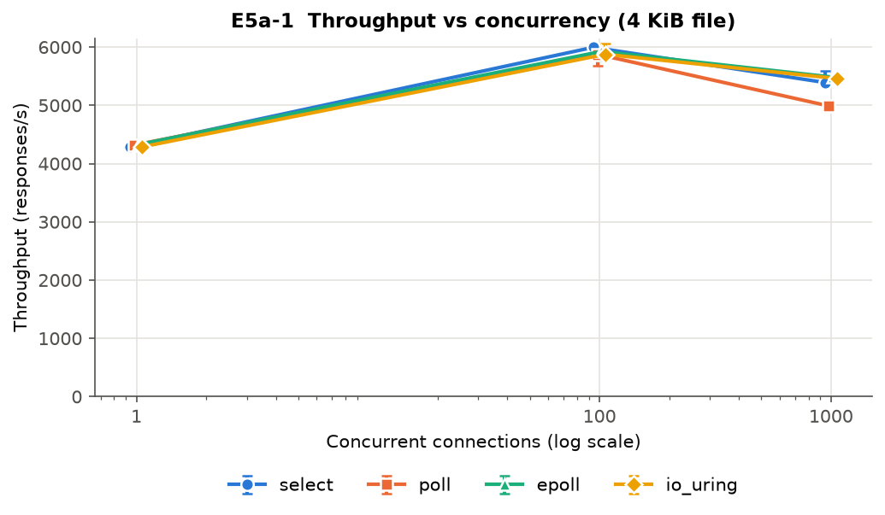

- **1 → 100 connections:** throughput rises by ~37% (4.3k → 5.9k req/s) on every backend. With one connection, the server sits idle while each request crosses the client. With 100, there is always work ready, and one wakeup serves many sockets.
- **100 → 1000 connections:** throughput falls by 7–15%. **poll drops the most (4,989 req/s vs 5,484 for epoll).** poll passes and scans the whole 1000-entry `pollfd` array on every call (O(n)). epoll returns only the ready sockets. select survives because it is still under `FD_SETSIZE` (1024).

### 2. Average latency vs concurrency (4 KiB)
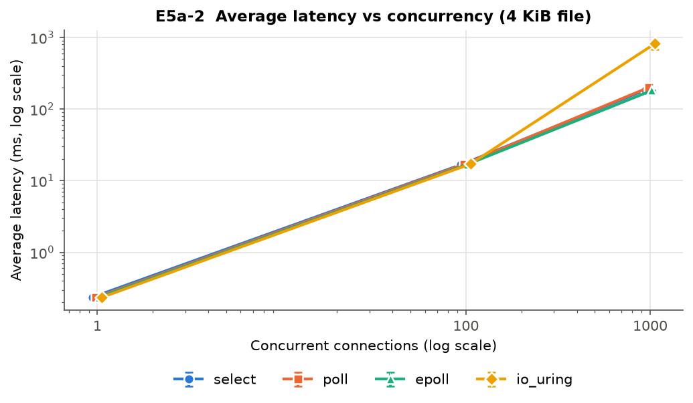

- Latency follows **Little's law** (latency = connections ÷ throughput): 100 / 5,925 ≈ 17 ms and 1000 / 5,484 ≈ 182 ms, which matches the measurements. Once the server is saturated, extra clients only add queueing delay.
- **io_uring at 1000 connections is the outlier:** mean 818 ms, p99 13.5 s, max ≈ 19 s, even though its throughput matches epoll. All 5 runs show this. Most requests are fast, but some connections are starved for seconds, so this is a **fairness problem, not a speed problem**. A likely cause is the order in which completions are reaped and requests re-armed when 1000 receives are in flight. The basic io_uring backend uses no multishot or provided buffers. We have not confirmed the root cause.

### 3. Throughput vs file size
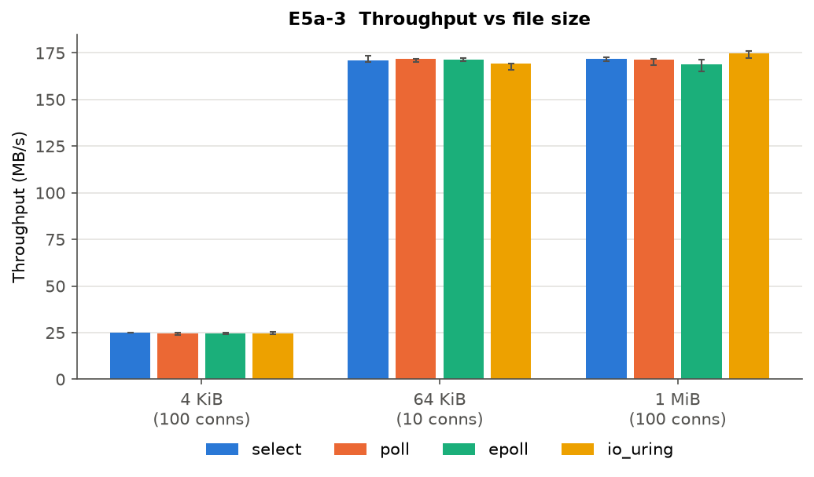

- **4 KiB: ~24.5 MB/s.** The cost per request dominates: parsing, two writes and an event-loop round trip, all for very little data.
- **64 KiB and 1 MiB: ~170 MB/s on every backend.** The cost per byte now dominates, and all four backends reach the same ceiling.
- The server's CPU use is only ~20% at this ceiling, so the bottleneck is the data path (user-space copies on both ends, loopback, WSL2), not event notification. io_uring needs ~12% less server CPU per 1 MiB response (1,179 µs vs 1,343 µs for epoll), but that does not raise throughput here.
- *Note:* the 64 KiB cell used 10 connections and the others used 100. Above ~64 KiB the result is bandwidth-bound, so this does not change the conclusion.

---

## E5b — Connection behaviour (close vs keep-alive)
4 KiB file, 100 connections, `--max-conns=300`. *Close* sends `Connection: close`, so wrk opens a new TCP connection for every file.

### 4. Throughput
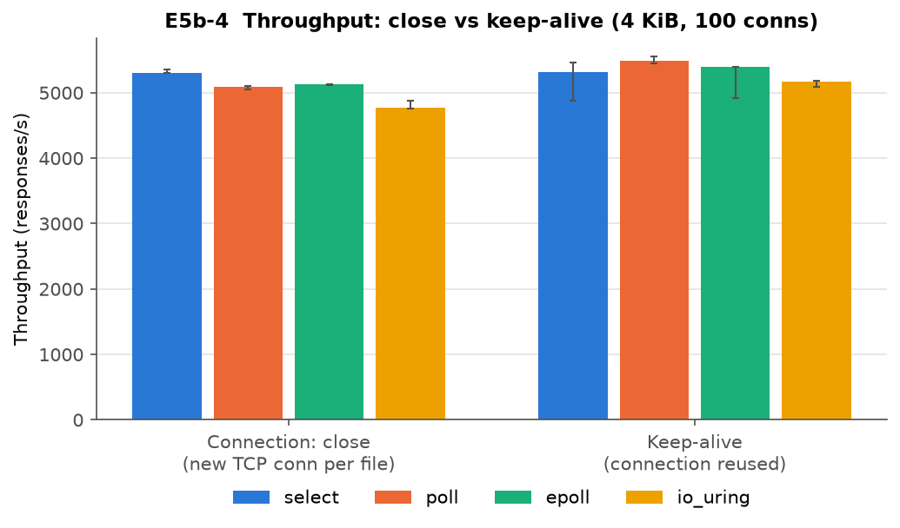

| Backend | Close (req/s) | Keep-alive (req/s) | Gain |
|---|---|---|---|
| select | 5,309 | 5,314 | 0% |
| poll | 5,090 | 5,488 | +7.8% |
| epoll | 5,125 | 5,389 | +5.2% |
| io_uring | 4,774 | 5,164 | +8.2% |

- Reusing connections avoids `accept()`, `close()`, the handshake, and backend registration for each new socket (`epoll_ctl` for epoll, fresh SQEs for io_uring). **io_uring gains the most** because its per-connection setup is the most expensive.
- The gain is small because loopback has almost no RTT. On a real network, every closed connection adds at least one RTT for the handshake, and keep-alive would win by much more.

### 5. Latency
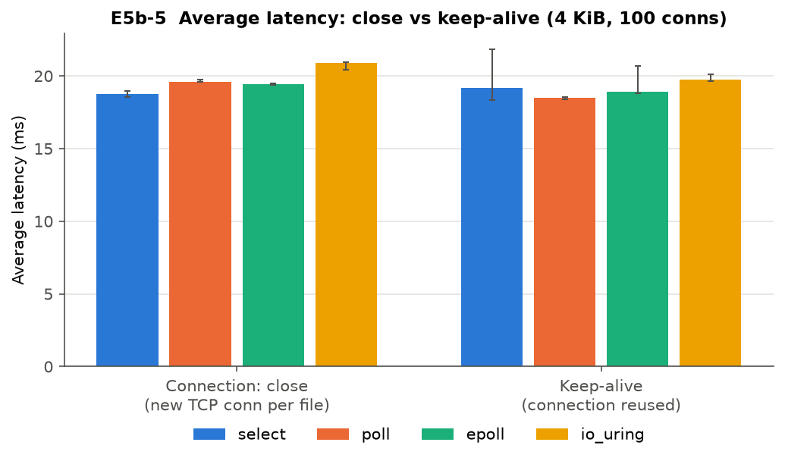

- Mean latency improves slightly with keep-alive (for example, io_uring 20.9 → 19.8 ms), which matches the throughput gain under Little's law.
- *Caveat:* close and keep-alive ran as separate campaigns at different times, so part of the difference may come from run-to-run variation.

---

## E7 — Buffer sensitivity
4 MiB file, 100 connections, application buffer 256 KiB.

### 6. Throughput vs buffer setting
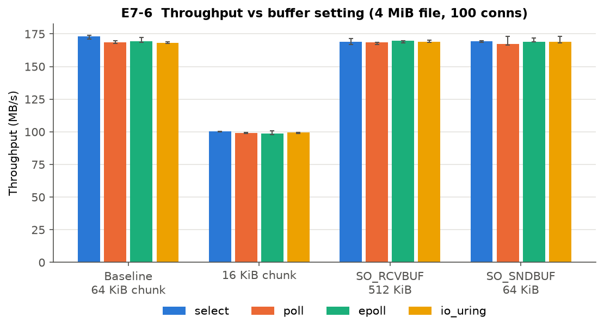

### 7. Latency vs buffer setting
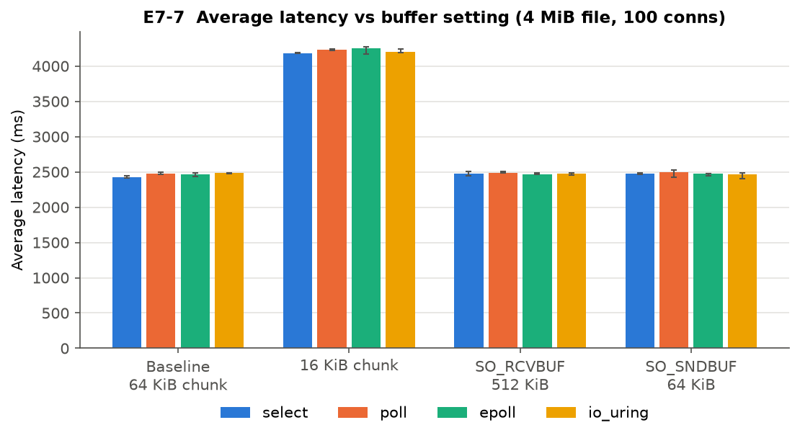

| Setting | Throughput | Latency per 4 MiB |
|---|---|---|
| Baseline (64 KiB chunk) | ~169 MB/s | ~2.5 s |
| **16 KiB chunk** | **~99 MB/s (−41%)** | **~4.2 s (+70%)** |
| SO_RCVBUF = 512 KiB | ~169 MB/s (no change) | ~2.5 s |
| SO_SNDBUF = 64 KiB | ~169 MB/s (no change) | ~2.5 s |

- **Chunk size is the parameter that matters.** Each chunk is one full cycle: file `read` → `write` → completion → next read. A 16 KiB chunk needs 4× as many cycles per file, and the cost per cycle is now the bottleneck. Larger chunks spread that fixed cost over more bytes.
- **SO_RCVBUF does nothing** because the server receives only a tiny `GET` request. The receive buffer never fills.
- **SO_SNDBUF = 64 KiB does nothing** because one 64 KiB chunk still fits in the buffer, and Linux doubles the requested value. Loopback drains it quickly.
- The backends are equal on median. io_uring's p99 is consistently higher (~3.7 s vs ~2.5 s), which matches the tail behaviour seen in E5a.

---

## E8 — Slow readers
100 fast wrk clients download a 100 MiB file. In addition, 0, 10 or 100 `curl` readers are each throttled to 100 KiB/s. The window is 90 s.

### 8. Throughput vs slow readers
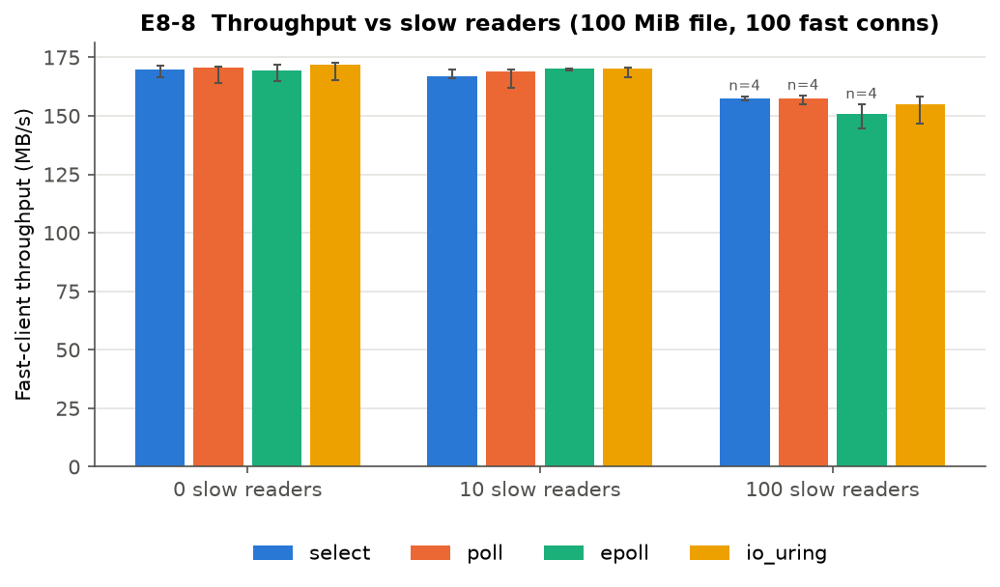

### 9. Latency vs slow readers
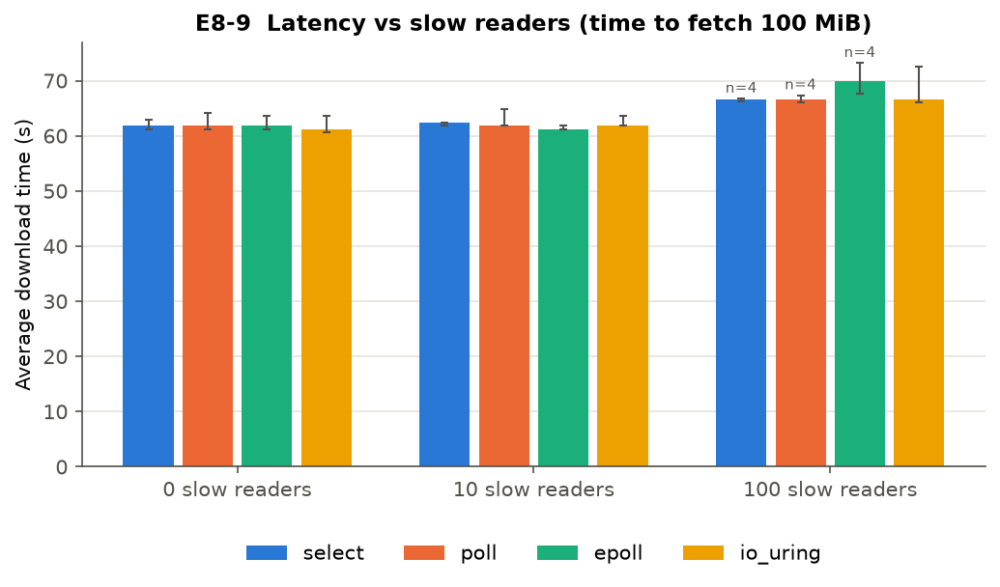

- **0 or 10 slow readers:** no measurable impact. Throughput stays at ~170 MB/s and each 100 MiB download takes ~62 s.
- **100 slow readers:** fast-client throughput falls to 151–158 MB/s (−7 to −11%) and download time rises to 67–70 s. epoll is affected most (150.6 MB/s, 69.9 s).
- **Why the impact is small:** all four servers are non-blocking. A slow reader's socket send buffer fills up and its write waits (`EAGAIN`, or a pending SQE), but the event loop keeps serving other clients. A slow client costs a socket and buffer memory, not loop time. The 100 slow readers together pull 100 × 100 KiB/s ≈ 10 MB/s. That is close to the bandwidth the fast clients lose, plus some per-socket overhead.
- **Rejected runs:** select, poll and epoll each lost **run 3** at 100 slow readers. In that run, none of the fast downloads finished inside the 90 s window (0 requests), so wrk reported no rate. The failure happened in the same run on three backends, which points to a host-side slowdown during that run rather than a backend bug. Those cells use n = 4 (labelled on the plots). io_uring kept 5/5.

---

## E9 — TCP_NODELAY
100 connections, 4 KiB and 64 KiB files. The only setting changed is `TCP_NODELAY` on the accepted sockets.

### 10. Throughput
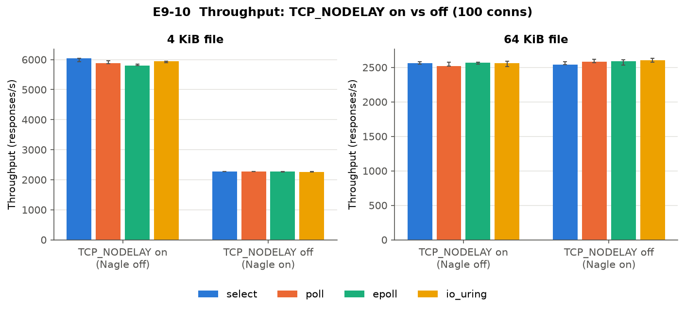

### 11. Latency
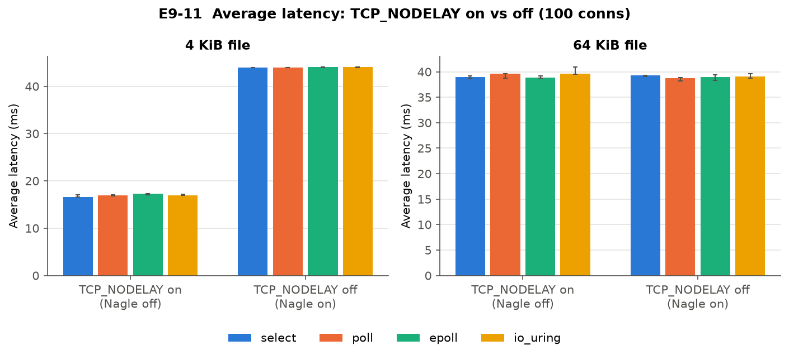

| File | NODELAY on | NODELAY off | Effect |
|---|---|---|---|
| 4 KiB | ~5.9k req/s, 17 ms | 2.27k req/s, 44 ms | **−62% throughput, 2.6× latency** |
| 64 KiB | ~2.56k req/s, 39 ms | ~2.58k req/s, 39 ms | none |

- **Why 4 KiB collapses (Nagle + delayed ACK):** the server sends the HTTP header and the file body as two separate `write()` calls. With Nagle on, the body is a small segment (loopback MSS ≈ 64 KiB), so TCP holds it until the header is ACKed. The client delays that ACK by Linux's ~40 ms delayed-ACK timer. Every response therefore waits about 40 ms. Check: 100 connections ÷ 44 ms ≈ **2,270 req/s**, which matches the measured value exactly on all four backends.
- **Why 64 KiB is unaffected:** the body fills full-sized segments, which Nagle sends immediately. The connection is also already at the ~170 MB/s ceiling.
- The effect is identical on every backend because it happens entirely in the kernel's TCP stack. **Recommendation:** keep TCP_NODELAY on (the current default), or write the header and body in one `writev()`.

---

## Conclusions

1. **For file transfer, the cost of moving bytes dominates and the cost of event notification is minor.** All four backends perform almost the same up to 100 connections and reach the same ~170 MB/s ceiling.
2. **Socket and protocol tuning matter more than the choice of backend:** TCP_NODELAY (2.6× latency), chunk size (−41% throughput), and connection reuse (up to +8%).
3. **Differences between backends only show at high fan-in:** poll's O(n) scan costs 9% at 1000 connections, and io_uring shows a serious tail-latency and fairness problem there.
4. **Limitations:** everything ran over loopback on WSL2, with no network RTT and no NIC, and with a single-threaded server. The E5a and E7 matrices are screening subsets, not full sweeps. E5b's two arms ran in separate campaigns.

## Reproducing

```bash
python report/file-transfer/make_figures.py
```
This reads the raw runs in `code/results/File Transfer Server/benchmarking-results/` (accepted runs only) and writes `figures/*.png` plus `data.json`, which holds the per-cell medians, IQR, n, and the list of rejected runs.
